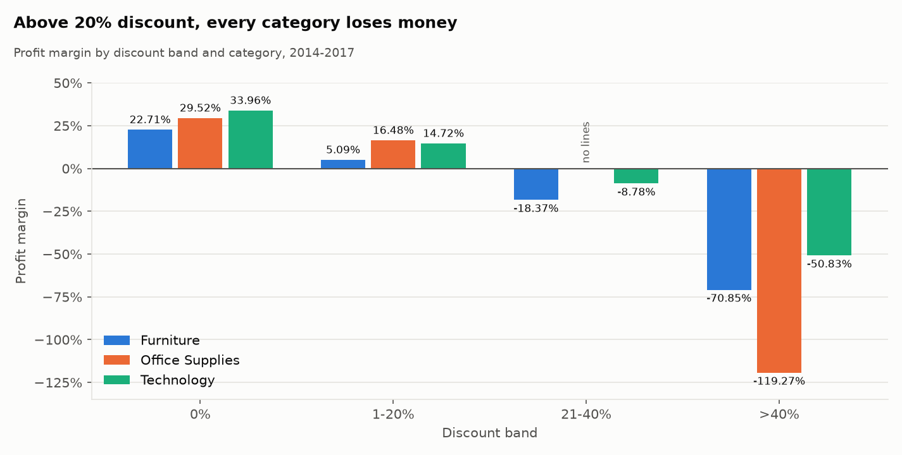
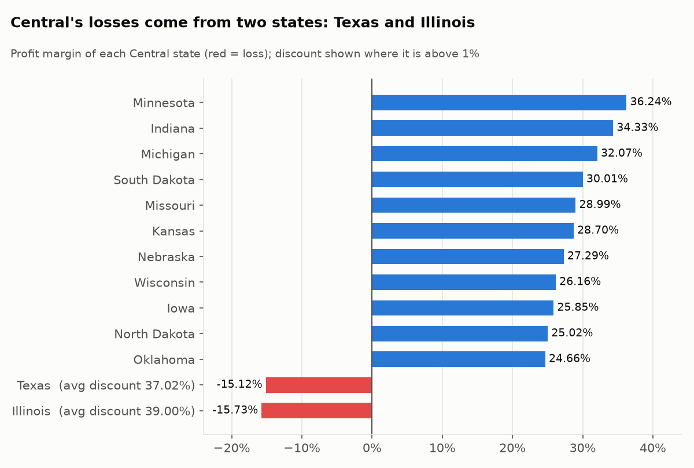
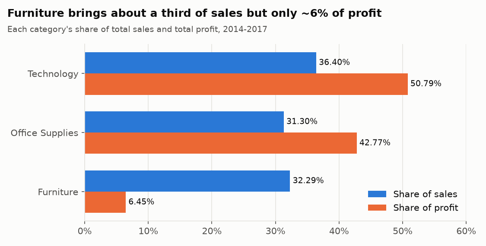
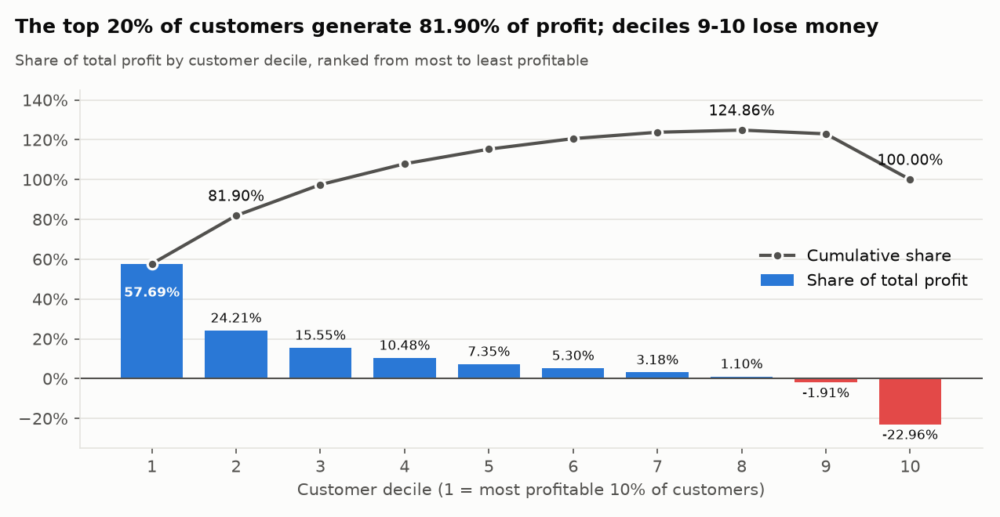
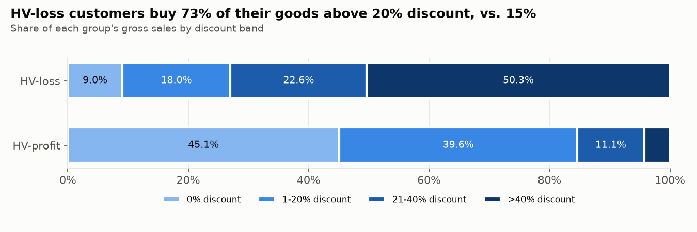
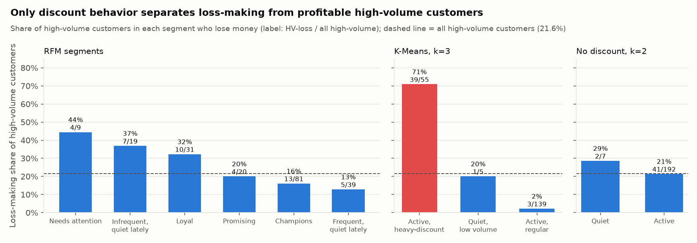
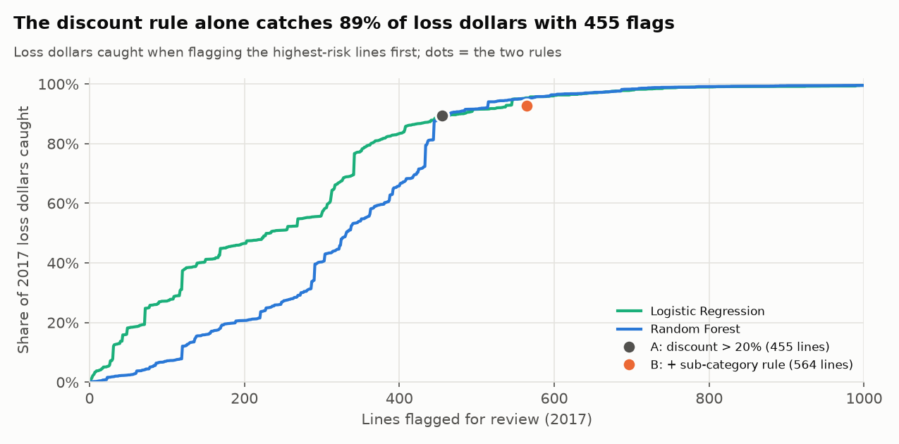
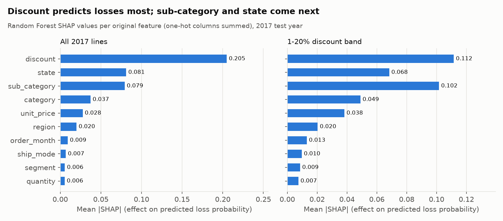
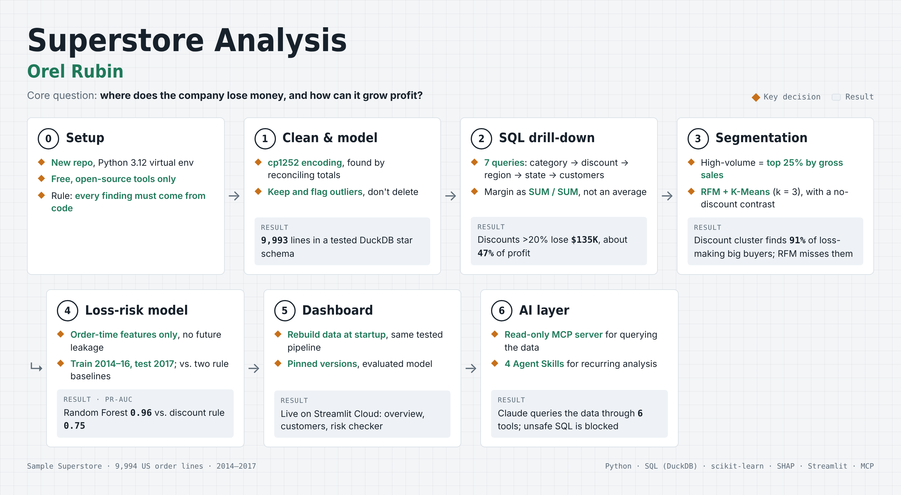

# Superstore Profit Intelligence

**Live demo:** [superstore-profit-intelligence-orel.streamlit.app](https://superstore-profit-intelligence-orel.streamlit.app/)
(interactive dashboard; the first visit may take ~15 seconds while the app wakes up and builds its data)

An end-to-end retail analytics project on the Sample Superstore dataset (9,994 US
order lines, 2014–2017). It covers data cleaning, a DuckDB star schema, SQL business
analysis, customer segmentation, a loss-risk model, an interactive Streamlit dashboard,
and an AI layer (an MCP server and Agent Skills) that lets Claude query the data.

**Core business question: where does the company lose money, and how can it grow profit?**

## Key findings

### SQL analysis (step 2)

- **Discounts above 20% lose money in every category.** With no discount, no order lines
  lose money. Above 20%, 78%–100% of lines lose money, for a combined **−$135,364**:
  about **47% of total profit** ($286,409).
- **Furniture is the weak category.** It brings about a third of sales but only **~6% of
  profit** (2.5% margin vs. ~17% elsewhere). Tables and Bookcases lose money and carry
  the highest average discounts (26.13% and 21.11%).
- **High discounts depend on region, not on customer segment.** **27.68%** of Central's
  lines are discounted above 20%, vs. **3.68%** in West. The three customer segments get
  almost identical discounts (13.30%–14.16%).
- **Inside Central it comes down to two states.** Texas and Illinois are the only Central
  states that discount (37.02% and 39.00% on average). Both lose money, and their
  high-discount lines account for all **$52,392** of Central's high-discount loss.
- **Growth is real, but 2017 was less profitable.** Sales grew about **+51.5%** from 2014
  to 2017. In 2017 the margin fell from 13.43% to 12.74%, while the share of high-discount
  lines stayed at ~14% every year.
- **Profit is concentrated in few customers.** The top 20% of customers generate
  **81.90%** of profit, while **155 of 793** customers lose money.

**So far:** most losses come from discounts above 20%, given mainly in specific states
rather than to specific customer types, under a policy that has stayed the same for
four years.

| Discount vs. margin | Central region by state |
|---|---|
|  |  |
| **Category shares** | **Customer Pareto** |
|  |  |

Full walkthrough with every query, table and chart:
[`notebooks/02_sql_findings.ipynb`](notebooks/02_sql_findings.ipynb).
Data quality and cleaning: [`notebooks/01_data_quality.ipynb`](notebooks/01_data_quality.ipynb).

### Customer segmentation (step 3)

*Question: who are the high-volume customers that generate net losses, and how do they
differ from profitable high-volume customers?* High-volume = top 25% of customers by
gross sales (before discount); 43 of these 199 customers lose money in total (−$52,784).

- **They are not smaller, newer or lapsing customers.** Their recency, tenure, frequency
  and volume are close to those of profitable high-volume customers.
- **73% of what they buy is discounted above 20%**, against 15%, and that discount mix
  explains **78–93% of the profit gap**.
- **They buy in high-discount states** (Texas, Ohio, Pennsylvania, Florida, North Carolina),
  not in the West, and over-index on **Machines and Binders**.
- **One deep discount usually decides it:** 25 of the 43 would be profitable without
  their single worst order line, and 41 of those worst lines are discounted above 20%.
- **RFM would rank half of them as top customers** (Champions or Loyal). K-Means with a
  discount-behavior feature puts **91%** of them in one cluster; without that feature,
  the clusters do not separate them at all.

**Recommendation** *(an inference from these results, not a tested finding)*: the problem is
how large orders are priced in specific states, not which customers the company serves.
A discount cap or approval step for deep discounts on Machines and Binders in the
high-discount states would target exactly the lines that turn good customers into
loss-makers. Its real effect (e.g. whether customers still buy without the discount) would
need a pilot or A/B test.

| Discount mix | Which segmentation finds them |
|---|---|
|  |  |

Full analysis with methods, sensitivity checks and caveats:
[`notebooks/03_customer_segmentation.ipynb`](notebooks/03_customer_segmentation.ipynb).

### Loss-risk model (step 4)

*Question: which features known at order time best predict loss-making order lines, and
can we flag them before fulfillment better than a simple discount rule?* Trained on
2014–2016, tested once on 2017; no customer-history features (they would leak the future).

- **Discount is by far the strongest predictor**, then sub-category and state, then
  category and list price. Ship mode, customer segment, order month and quantity add
  almost nothing (SHAP, confirmed by permutation importance).
- **The discount rule is hard to beat in dollars.** "Flag if discount > 20%" catches
  **89% of 2017 loss dollars** with 455 flags, 98% of them correct; at that budget the
  models flag nearly the same lines and catch the same 89%.
- **The models win where the rule is blind.** PR-AUC: rule 0.75, rule + sub-category 0.92,
  Logistic Regression 0.95, **Random Forest 0.96**. In the 1–20% discount band the Random
  Forest clearly beats the two-variable rule (PR-AUC 0.56 vs. 0.42, paired 95% CI for the
  difference +0.09 to +0.20), but that band holds only ~11% of 2017 loss dollars.

**Recommendation** *(an inference, not a tested finding)*: use the discount rule as the
first control and the model only to review lines discounted 1–20%.

| Loss dollars caught vs. lines flagged | Strongest predictors (SHAP) |
|---|---|
|  |  |

Full analysis: [`notebooks/04_loss_risk_model.ipynb`](notebooks/04_loss_risk_model.ipynb).

## Project flow



## Interactive dashboard (step 5)

A three-page Streamlit app built from the same tested code as the notebooks:

| Page | What it shows |
|---|---|
| **Overview** | sales, profit, margin and profit on >20%-discount lines, plus margin by discount band; filters for category, region and state |
| **Customers** | loss-making vs. profitable high-volume customers, their discount mix, and where they fall in the K-Means clusters |
| **Loss-risk checker** | pick a sub-category, state, discount and quantity; get the model's predicted loss risk, what the two discount rules would say, how similar past lines turned out, and a SHAP explanation |

On first start the app rebuilds the DuckDB database from the raw CSV in this repo
(the `.duckdb` file is not in git) and trains the step 4 Random Forest on 2014–2016 with
the settings tuned in notebook 04; both are cached, so later visits are instant.

## Project structure

```
data/raw/              original CSV (never modified)
data/processed/        orders_clean.parquet + superstore.duckdb (built locally)
src/cleaning.py        load, validate and clean the raw data; data-quality log
src/build_database.py  DuckDB star schema + integrity checks
src/run_sql.py         run any .sql file and print the result
src/customer_features.py  customer-level RFM, discount, product and region features
src/segmentation.py    RFM scoring, R x F segments, K-Means with k-selection checks
src/customer_comparison.py  step 3 comparisons with bootstrap confidence intervals
src/loss_model.py      step 4 baselines, Logistic Regression, Random Forest, SHAP
streamlit_app.py       dashboard entry point (page navigation)
app/data.py            cached database build, table loaders and model training
app/views/             dashboard pages: overview, customers, risk_checker
src/mcp_server.py      MCP server: read-only SQL, schema, saved queries, loss-risk model
.mcp.json              registers the MCP server with Claude Code for this project
.claude/skills/        Agent Skills: profit-drilldown, sql-review, loss-risk-check, verify-project
sql/01-07_*.sql        business queries, each with question + insight in its header
sql/SCHEMA.md          every table, column and type in the database
tests/                 pytest checks: keys, reconciliation with raw data, feature recomputation,
                       leakage guards, dashboard pages (Streamlit AppTest), MCP server
                       safety and protocol
notebooks/             01 data quality, 02 SQL findings, 03 customer segmentation,
                       04 loss-risk model
reports/figures/       charts used in this README
```

**Data model:** `fact_order_lines` with `dim_customer`, `dim_product`, `dim_location` and
`dim_date`, plus a wide `orders_clean` table and an order-level `orders` view. Step 3 adds
customer-level tables: `customer_features`, `customer_mix`, `customer_rfm` and
`customer_clusters`.

**Tech stack:** Python 3.12, pandas, DuckDB (SQL), scikit-learn, SHAP, SciPy, matplotlib,
Streamlit, Altair, MCP Python SDK, Jupyter, pytest, pyarrow. All free and open source;
exact versions are pinned in `requirements.txt` (dashboard and analysis) and
`requirements-mcp.txt` (adds the MCP SDK, so the dashboard's install stays lean).

## How to run (Windows PowerShell)

```powershell
git clone https://github.com/orelrubin2/superstore-profit-intelligence.git
cd superstore-profit-intelligence
python -m venv .venv
.venv\Scripts\Activate.ps1
pip install -r requirements.txt

python -m src.build_database                            # clean data + build DuckDB (~3 s)
python -m pytest                                        # integrity tests
python -m src.run_sql sql/03_discount_impact_by_category.sql   # run any query
streamlit run streamlit_app.py                          # dashboard at http://localhost:8501
```

On macOS/Linux, activate with `source .venv/bin/activate`.

### Deploy the dashboard on Streamlit Community Cloud (free)

1. Sign in at [share.streamlit.io](https://share.streamlit.io) with the GitHub account that
   owns this repo, and allow Streamlit access to it.
2. Click **Create app** → **Deploy a public app from GitHub**.
3. Repository: `orelrubin2/superstore-profit-intelligence`, branch: `main`,
   main file path: `streamlit_app.py`.
4. Optional: choose an app URL (subdomain).
5. Open **Advanced settings** and select **Python 3.12**. No secrets are needed.
6. Click **Deploy**. The first start installs `requirements.txt` (a few minutes), then
   builds the database and trains the model (about 15 seconds) on the first visit.

## Roadmap

| Step |
|---|
| 1. Data cleaning and DuckDB database |
| 2. SQL business analysis |
| 3. Customer segmentation: RFM scoring and K-Means, comparing loss-making and profitable high-volume customers |
| 4. ML: loss-risk classifier (Random Forest vs. a discount-rule baseline and Logistic Regression), with SHAP |
| 5. Streamlit dashboard | 
| 6. AI layer: Agent Skills and an MCP server for querying the data with Claude | 

**Future ideas:** a monthly sales forecast.

## AI layer: query the data with Claude (step 6)

A local **MCP server** (`src/mcp_server.py`, stdio, no hosting) gives Claude Code direct,
read-only access to the project's database and model:

| Tool | What it does |
|---|---|
| `list_tables`, `describe_table` | the data model, with descriptions from `sql/SCHEMA.md` |
| `run_sql` | one read-only `SELECT`, capped at 200 rows |
| `list_saved_queries`, `run_saved_query` | the `sql/01–07` business queries: question, insight and live result |
| `predict_loss_risk` | the step 4 model for one order line: risk, both discount rules, top SHAP factors, history |

**Safety:** the DuckDB connection is read-only with external access disabled and its
settings locked, so SQL cannot write, read or write files, attach databases or install
extensions; on top of that, `run_sql` accepts exactly one `SELECT`. Tests try each of these.

Four project **Agent Skills** (`.claude/skills/`) package recurring tasks; Claude Code
loads them automatically, or you can invoke them by name:

| Skill | Use it for |
|---|---|
| `profit-drilldown` | "Where does Furniture in the East lose money?" -the standard category → sub-category → discount → state → customer drill-down |
| `sql-review` | review a `sql/*.sql` file: conventions, a live run, and a check of every number in its header |
| `loss-risk-check` | "Is 10 binders to Texas at 30% off risky?" -model risk, rules, factors, a safer alternative |
| `verify-project` | rebuild, run all tests, and re-check the README's key numbers |

**Set up (Windows PowerShell, from the project root):**
```powershell
pip install -r requirements-mcp.txt     # adds the MCP SDK to the environment
python -m src.build_database            # optional: the server builds it on first use
claude                                  # start Claude Code; approve the "superstore" server when asked
```
`.mcp.json` registers the server for this project. On macOS/Linux, register it instead with
`claude mcp add superstore -- .venv/bin/python -m src.mcp_server`.

**Cost and privacy:** the server and SDK are free and run locally. Query results that Claude
reads become part of the conversation, which is fine for this public dataset; review that
before reusing the pattern with private data.

## How I worked with AI

I led the project and used Claude as a collaborator for both thinking and execution:

- **My role:** I set the goal and the rules (every finding must come from code in
  this repository, no assumed results), reviewed and approved each plan, chose
  which direction to take after each result, and checked every number and insight
  against the query output before committing.
- **Claude as an analysis partner:** we developed the drill-down together
  (category, sub-category, discount, region, state, time, customers). Claude
  proposed next questions and drafted queries 03-07, including the more advanced
  SQL (window functions, `LAG`, CTEs, `NTILE`), with explanations. I wrote the early
  queries (01-02) myself, and I ran, verified and interpreted all seven.
- **Claude Code as a pair programmer:** it built the pipeline under my review:
  cleaning, the DuckDB schema, integrity tests, the `run_sql` runner and the notebooks.

The project rules for the AI are in [`CLAUDE.md`](CLAUDE.md).

## Data

Sample Superstore
(Kaggle). The file is Windows-1252 encoded. 449 postal codes lose their leading zero
if read as numbers, and one duplicate row is removed; all of this is documented in
`notebooks/01_data_quality.ipynb`.

License: MIT.
